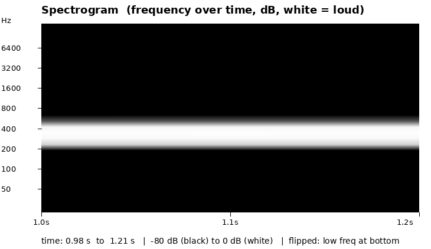

# Auris: a deterministic sense of hearing

Version 0.3.0. License: Apache-2.0. Python 3.9 or later. Dependency: numpy.

[](https://github.com/VektorGeist/auris/actions/workflows/tests.yml)

Auris turns sound into a spatial field, reads that field into structured
text, remembers what it hears, and recognises remembered sounds. Every
stage is signal processing, geometry, and remembered exemplars. No AI
model is called anywhere in the package.


Sample output, from a generated 220 Hz chord:

```bash
python -m auris.cli tone --kind chord --freq 220 --dur 2 --out chord.wav
python -m auris.cli hear chord.wav
```

> a pitched tone, E4 at 330.6 Hz (+5 cents from exact E4), very loud,
> dark in timbre, energy centred around 336 Hz (low-mid), steady /
> sustained, pitch falling, plate modes ringing strongest: (1,2) 0.52,
> (0,2) 0.23, (0,3) 0.18.

## Quick start

```bash
pip install git+https://github.com/VektorGeist/auris
```

Or from a clone of this repository:

```bash
pip install .
```

Optional extras: `pip install .[dev]` for the test suite, `pip install
.[mic]` for live microphone capture.

## Modules

| Module | What it does |
|---|---|
| `audio_engine.py` | Feature extraction: band energies (bass, mid, high), loudness, spectral centroid, spectral flux, and fundamental frequency per frame |
| `cochlea.py` | Tonotopic place map: 32 places on a log-frequency layout from 20 Hz to 16,000 Hz, per-frame place energies, raw energy, and spectral flatness |
| `audio_io.py` | WAV read and write, and block iteration, using the standard library wave module |
| `render.py` | Builds the spatial field (frequency by time, weighted by loudness), saves it as a PGM image, and reads it back into numbers |
| `chladni.py` | Square plate model: a fixed table of 78 modes, each with its own resonant frequency, weighted by the energy a sound's whole spectrum carries near that frequency |
| `spectrotemporal.py` | A 24-step by 32-place auditory image of a sound's trajectory over time, matched by dynamic time warping |
| `perceive.py` | Turns the field into structured text: note names with signed cents, loudness and brightness words, and frequency region words |
| `sense.py` | The whole sense wired together: capture, cochlea, aggregation, perception, gallery recognition, and episodic memory |
| `hippocampus.py` | Episodic memory: imprint, consolidation (salience at least 0.5, or at least 3 repeats within duplicate distance 0.1), and pattern-completion recall |
| `gallery.py` | Recognition against remembered sounds, by tonotopic descriptor and by spectrotemporal trajectory |
| `calibrate.py` | Sets recognition thresholds from measured separation between labelled exemplars |
| `phonetics.py` | Phonetic features per frame: voicing, vowel, fricative, plosive and nasal fractions, and voice onset time |
| `formants.py` | Formant tracking: the lowest resonant peaks (F1, F2, F3) per frame |
| `words.py` | A remembered store of spoken-word sound-forms, matched by trajectory distance |
| `token_pack.py` | Assembles one token pack per audio file, one block per time segment |
| `polyphony.py` | Multi-pitch candidate list: harmonic-stack scores for MIDI 21 to 108, top 5 |
| `labeled_images.py` | Draws labels and scales onto token pack images, written alongside the originals |
| `tones.py` | Deterministic synthetic sounds, generated with numpy and seeded noise |
| `listen.py` | Live microphone capture through an optional sounddevice backend |
| `cli.py` | Command line interface |

The pitch path reads one dominant pitch at a time. Pitch search runs
from 20 Hz to 5,000 Hz on a zero-padded 16,384-point FFT. All 88 piano
keys, A0 to C8, return correctly named pitches.

## Use

```bash
python -m auris.cli tone --kind tone --freq 440 --dur 1 --out a.wav
python -m auris.cli hear a.wav
python -m auris.cli hear a.wav --mode render
python -m auris.cli remember a.wav "the A"
python -m auris.cli recall a.wav
python -m auris.cli consolidate
python -m auris.cli stats
```

## Chladni patterns

```python
from auris import Ear

ear = Ear()
figures = ear.chladni(samples, sr, size=128)

figures = ear.chladni_file("song.wav", size=128, as_images=True)
```

Or use the module directly:

```python
from auris import chladni

field = chladni.chladni_field(n=3, m=4, size=128)

figures = chladni.chladni_timeline(percepts)

strip = chladni.chladni_strip(percepts, size=128)
```

Each mode (n, m) carries the resonant frequency 55 x (n^2 + m^2) Hz,
spanning 55 Hz to 14,575 Hz, with a resonance width of 0.25 octaves.
Mode weights are numbers, and they travel in the readout and in every
token pack segment.

## Token packs

```bash
python -m auris.token_pack input.wav --segments 20 --out out_dir
python -m auris.token_pack input.wav --segments 20 --out out_dir --no-images
python -m auris.token_pack input.wav --segments 20 --out out_dir --labeled-images
```

Each segment of a token pack carries: structured text; pitch, loudness,
centroid, peak Hz, region, and trends; Chladni mode weights; a gallery
match; polyphony candidates; and an oscilloscope waveform channel with
peak, RMS, and zero crossings per segment, plus a waveform image.



## Measured values

- Gallery match thresholds are set to the measured equal-error points
  on synthetic exam sets: 0.0533 for trajectory matching, 0.0587 for
  descriptor matching. They are not calibrated on real recordings.
- On the synthetic exam sets, trajectory matching scored 84% and
  descriptor matching 72% after the current cochlea build.
- The test suite contains 45 tests.

## Capabilities and limits

- Speech output is phonetic features and a word verdict with cohort
  confidence. It is not transcription.
- Polyphony output is a candidate list of up to 5 pitches. It is not a
  clean voicing, candidates fail on noisy sounds, and sequential notes
  inside one window are not recovered as a full set.
- Labels on Chladni and spectrogram images copy their numbers from the
  pack data. A Chladni pattern alone does not uniquely identify its
  mode numbers, and spectrogram frequency ticks are interpolated on
  the cochlea centre scale.
- The oscilloscope waveform is a token pack channel. The core ear does
  not use an oscilloscope internally.

## Test

```bash
python -m pytest tests/ -v
```

Data lives in `~/.auris/` (override with `AURIS_DIR`).
